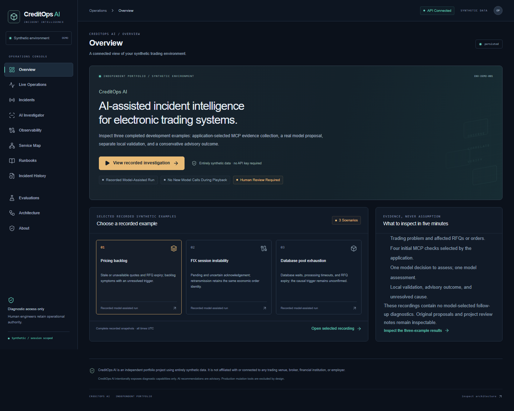
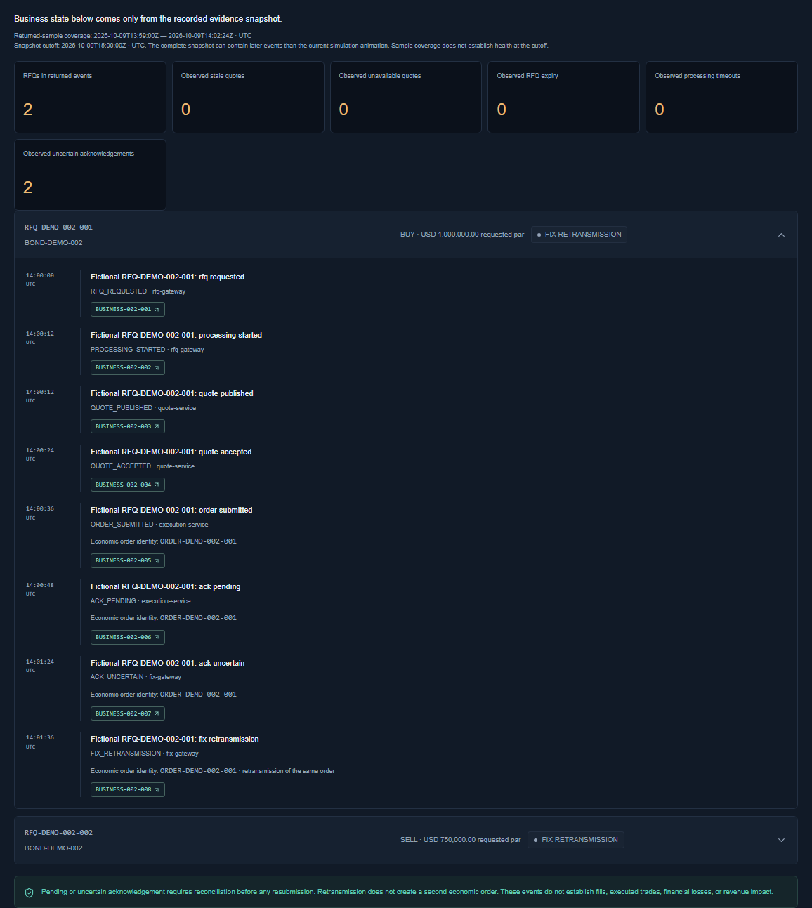
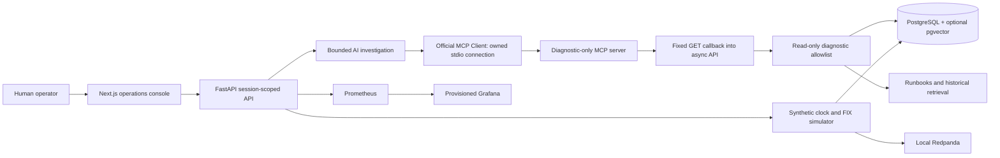

# CreditOps AI

**AI-assisted incident intelligence for synthetic electronic credit trading systems.**

Open three recorded model-assisted investigations of pricing backlog, FIX session instability and database pool exhaustion. Follow the synthetic trading problem, affected RFQs/orders, application-selected MCP evidence, original model proposal, separate validation and conservative advisory outcome. Every outcome requires human review; the initiating causes remain unconfirmed.

> CreditOps AI is an independent portfolio project using entirely synthetic data. It is not affiliated with or connected to any trading venue, broker, financial institution, or employer.



## Open the keyless showcase

After the one-time dependency setup below, run `pnpm showcase` and open [the console](http://127.0.0.1:3000).

1. Choose **Pricing backlog**, **FIX session instability**, or **Database pool exhaustion**, then select **View recorded investigation**.
2. Review the trading problem and recorded business impact: stale/unavailable quotes and RFQ expiry; uncertain acknowledgements and retransmission of the same order; or DB wait, processing timeouts and RFQ expiry.
3. Follow four initial checks selected by the application, one model decision selecting assessment, one recorded model assessment and local validation. These recordings contain no model-selected diagnostic follow-ups.
4. Click evidence IDs, then expand **Original model proposal and review notes** to compare original statements with the recorded advisory output and validation changes.
5. Open **Evaluations** for **Selected recorded synthetic examples**. The separate legacy benchmark and robustness reports remain available.

**Entirely synthetic data · Recorded model-assisted run · No new model calls during playback · Human review required.** The three completed OpenAI recordings use `gpt-5.4-mini-2026-03-17` and the frozen `evidence_first_v1` workflow. They are selected development examples, with earlier failed attempts and abstention preserved in the [verification history](docs/LIVE_VERIFICATION_REPORT.md). They are not autonomous investigations or a general-accuracy benchmark.

Replay preserves original proposals, validation outcomes, final assessments, evidence IDs and observation timestamps from sanitized derivatives in [data/showcase](data/showcase). The complete recorded snapshot is distinct from the visitor's current animation: returned samples end at **2026-10-09 14:02:24 UTC**, before the **15:00 UTC** cutoff. Original generation time, export time and playback time are labeled separately. Keyless **MCP · adaptive deterministic** remains a separate mode that makes fresh read-only protocol calls using application rules; its tool sequence is not part of these live-model recordings.



Follow the [30-second introduction and two-minute click-through](docs/DEMO_SCRIPT.md) or the [five-minute technical walkthrough](docs/INTERVIEW_WALKTHROUGH.md). The [short showcase playback video](docs/screenshots/showcase-playback.webm) records local playback with no new model calls. Inspect the [original proposal and validation](docs/screenshots/showcase-proposal-validation.png), [final advisory output](docs/screenshots/showcase-final-advisory.png), [evidence drawer](docs/screenshots/showcase-impact-evidence.png) and [three-example results](docs/screenshots/showcase-results.png). The existing [deterministic video](docs/screenshots/demo.webm) remains a historical recording of the separate deterministic experience.

| Selected recorded synthetic example | Original generation duration | Advisory outcome |
|---|---:|---|
| Pricing backlog · INC-DEMO-001 | 25.191 s | Supported condition; initiating cause unknown |
| FIX session instability · INC-DEMO-002 | 19.019 s | Supported condition; execution and initiating cause unresolved |
| Database pool exhaustion · INC-DEMO-003 | 16.138 s | Supported condition; initiating cause unknown |

Valid citation IDs do not guarantee truthful prose: the original proposals overstate some causal, trend, exclusion and temporal claims. Project review notes identify these limitations; they are not an independent audit. Recorded latency is not measured human time saved.

## The incidents

| Scenario | Independent observations | Probable failure domain |
|---|---|---|
| RFQ latency | Pricing consumer backlog, stale prices, quote age and upstream latency; healthy negative controls | Pricing service / Kafka consumer backlog |
| Acknowledgement delays | FIX heartbeat failures, reconnects, sequence gaps, uncertain synthetic orders; healthy DB/Kafka | FIX session instability |
| Request timeouts | Saturated connection pool, waiters and pool timeout logs, normal CPU | Connection pool exhaustion; a relevant preceding release is only a candidate trigger |

Twelve further labeled cases include stale market data, risk dependency timeouts, CPU pressure and three deliberately insufficient-evidence cases. Evaluation labels never enter diagnostic tools or model context.

## Architecture



The MCP-backed worker uses the official client, discovers and checks schemas, then receives diagnostic evidence through an owned stdio server and fixed API callback. Local evaluation explicitly uses a direct adapter. There is no silent transport fallback. SQLite supports lightweight development; Docker exercises PostgreSQL and a real Kafka-compatible broker. The [architecture document](docs/ARCHITECTURE.md) describes the boundaries.

Three fictional corporate bonds and event-derived RFQ/quote/order timelines connect telemetry to affected requests. Par amounts and clean prices use decimal strings with explicit currency and per-100-par units. They are not revenue, P&L or settlement values. Missing FIX acknowledgements remain PENDING/UNKNOWN until reconciled; the application never infers execution or creates a replacement order.

## Start locally

Requirements: Python 3.12+, Node.js 22+, pnpm, Git. Docker is optional for the lightweight path.

```sh
python -m venv .venv
# macOS/Linux: source .venv/bin/activate
# Windows PowerShell: .venv\Scripts\Activate.ps1
python -m pip install -r requirements.lock
python -m pip install --no-deps -e .
pnpm install --frozen-lockfile
pnpm showcase
```

Open [the console](http://127.0.0.1:3000), [API health](http://127.0.0.1:8000/health) and [OpenAPI](http://127.0.0.1:8000/docs). `pnpm showcase` starts both servers, initializes its dedicated SQLite store at `artifacts/runtime/showcase.db`, selects `data/showcase`, removes inherited provider/admin keys and bypasses the owner's `.env`. It forces `PUBLIC_DEMO=true`, `EMBEDDINGS_ENABLED=false` and persisted telemetry. Ctrl+C stops the owned servers. Public API requests for paid `LIVE_AI` are denied even if a fake or accidental credential is present.

On Windows without activating the environment, replace `python` with `.venv\Scripts\python.exe`. The launcher uses the repository `.venv` by default; `PYTHON` may name an existing absolute Python executable. No `.env`, model key, admin secret, raw local receipt directory, migration or evaluation regeneration is needed for showcase playback. `pnpm dev` remains available for general development with the ordinary local configuration.

## Full local infrastructure

```sh
docker compose -f infra/docker/compose.yml up --build -d
docker compose -f infra/docker/compose.yml ps
```

| Component | Isolated local URL |
|---|---|
| Web | http://localhost:13000 |
| API / OpenAPI | http://localhost:18000/docs |
| PostgreSQL / pgvector | localhost:15432 |
| Redpanda Kafka | localhost:19092 |
| Prometheus | http://localhost:19090 |
| Grafana | http://localhost:13001 |

All host ports bind to loopback. Disposable local credentials in Compose are intentionally fictional and must be replaced for hosting. `docker compose ... down` stops the stack while preserving its named volumes. No real FIX connection is created.

## Developer commands

| Command | Purpose |
|---|---|
| `pnpm dev` / `make dev` | Start API and console |
| `pnpm showcase` | Start isolated keyless public showcase using three recorded model-assisted runs |
| `pnpm test` / `make test` | Python and frontend unit tests |
| `pnpm lint` / `make lint` | Python and frontend lint |
| `pnpm typecheck` | Strict frontend TypeScript |
| `pnpm test:dependencies` | Scoped lint dependency compatibility and active rule checks |
| `pnpm test:lifecycle` | Real Playwright/Linux launcher shutdown and descendant cleanup; explicit Unix-proof skip on Windows |
| `pnpm e2e` | Playwright all-scenario and responsive checks |
| `pnpm e2e:showcase` | Keyless three-recording playback and public boundary browser checks |
| `pnpm test:showcase-startup` | Offline inherited-credential and isolated-storage launcher checks |
| `make seed` | Idempotent seed |
| `make eval` | Generate the unchanged 15-case benchmark and versioned replay artifacts |
| `python scripts/robustness.py` | Separate 13-case synthetic robustness/regression report |
| `make reset-demo` | Reset a selected local demo session |

Python packages are pinned in `requirements.lock`; pnpm dependencies are pinned in `pnpm-lock.yaml`. CI runs tests, lint, typecheck, E2E, dependency audits, Bandit and secret scanning.

## Why production mutation is intentionally excluded

CreditOps AI intentionally exposes diagnostic capabilities only. AI recommendations are advisory. Production mutation tools are excluded by design.

AI accelerates evidence collection and diagnosis while human engineers retain operational authority. There is no restart, rollback, scaling, record deletion, shell execution, configuration change or FIX termination tool. Read-only MCP registration and attempted forbidden actions are tested. Runbook commands are reference text and are never automatically executed. Every RCA is **Draft — human review required**.

## Engineering decisions

- **Evidence-grounded investigation:** structured assessments are checked against returned evidence IDs and evidence types. Unknown references invalidate output. Insufficient corroboration causes abstention and escalation.
- **Retrieval:** bounded diagnostic queries and explainable lexical ranking select context rather than dumping entire log stores into a model. Optional pgvector retrieval is available when configured.
- **Replay for public demos:** sanitized persisted artifacts work without keys and preserve the original model proposal, validation and final advisory assessment. Original generation, export, playback and observation times stay distinct.
- **Local Kafka, inexpensive cloud:** Redpanda supports real event publication/consumption locally. The public path uses persisted synthetic telemetry without a paid Kafka cluster.
- **Provider abstraction:** official SDKs, server-side configuration, validated tool plans, structured output, request deadlines and no automatic retries that could multiply costs.
- **Support and uncertainty:** scores are uncalibrated rule support, not probabilities. Every assessment requires human review. Valid references do not establish causality; the known-domain rule gate is not a general factuality verifier.

See [tradeoffs](docs/TRADEOFFS.md) for institutional-scale limitations.

## Evaluation methodology

The original 15-case labels remain unchanged, and their original results are preserved under [baseline-v1](artifacts/eval/baseline-v1/latest.md). Current output measures literal label accuracy, evidence recall, invalid references, abstention, escalation and latency. Legacy DB labels include an unsupported causal qualifier and expect some drafts to omit human review, so the corrected implementation reports those mismatches instead of relabeling for a perfect score. The legacy `hallucinated_evidence_count` field means invalid IDs only.

Actual results are in [generated JSON](artifacts/eval/latest.json), [generated report](artifacts/eval/latest.md) and the Evaluations page. These are small, in-distribution fixtures designed alongside the rules. They do not prove generalization, guaranteed AI accuracy, actual customer usage or real production MTTR reduction.

The separate [13-case robustness report](artifacts/robustness/latest.md) checks declared condition/trigger/uncertainty expectations, including missing and contradictory evidence. It is developer-authored and not independently held out. Scripted adaptation, real MCP transport and offline provider-SDK tests have separate receipts in the [second-pass report](docs/SECOND_PASS_REPORT.md). Zero invalid references does not mean zero hallucinations.

The selected live-model recordings are a separate development-example series, not replacement benchmark results. All three preserve four application-selected diagnostic calls, zero model-selected diagnostic follow-ups, one model decision and one assessment. Earlier failures and abstention remain part of the [verification history](docs/LIVE_VERIFICATION_REPORT.md). The three recorded usage estimates total USD 0.09934275; confirmed billing is unknown, and this is not total hosting cost. Historical retained reservations remain USD 1.03060200. No provider inference, embeddings or cloud mutation occurs in this packaging milestone.

Technical detail: original model scores are 0.63/0.78/0.87, while the final rule support score is 0.84 for every case. Both are uncalibrated; rule support is not AI confidence or an accuracy percentage. Recorded validation accepted the three known synthetic domains and normalized 19/17/19 distinct fields. These counts are not counts of independently detected errors.

`scripts/evaluate.py` remains offline only. The protected live runner is a separate development tool requiring explicit source-bound authorization, configured credentials and conservative budget accounting; unused historical allocation does not authorize another run.

## MCP

The [MCP README](apps/mcp/README.md) includes compatible-client configuration. Ten tools inspect incidents, logs, metrics, dependencies, changes, historical incidents, runbooks, Kafka, FIX and database health. Typed arguments reject unknown fields, enforce bounded results and sanitize secrets. Stdio works locally; hosted Streamable HTTP requires explicit protection.

## Security and configuration

`PUBLIC_DEMO=true` denies paid `LIVE_AI` and query embeddings at the API boundary, including when credentials accidentally exist. In a separate private development profile, `LIVE_AI` requires a configured server admin key and `Authorization: Bearer ...`, plus an investigation budget. Demo state is scoped to UUID sessions. Request-size caps, result limits, timeouts, log sanitization and evidence validation bound the attack surface. Untrusted telemetry cannot add tools or alter system instructions. An injection fixture and direct tests exercise this boundary. Session identifiers are capability tokens for synthetic data, not customer authentication.

The [version-controlled investigator prompt](apps/api/creditops/prompts/investigator.md) and [security document](docs/SECURITY.md) explain the threat model. The current single-instance in-memory rate limiter needs a shared store before multi-replica hosting. An admin key is a minimal demonstration mechanism, not institutional identity management.

| Variable | Role |
|---|---|
| `DATABASE_URL` | SQLite or asynchronous PostgreSQL URL |
| `API_BASE_URL` | Server-side Next.js proxy destination |
| `TELEMETRY_MODE`, `KAFKA_BOOTSTRAP_SERVERS` | Persisted demo or local Kafka adapter |
| `PUBLIC_DEMO` | Defaults true; denies paid live investigations and embedding queries |
| `REPLAY_DIR` | Showcase uses `data/showcase`; ordinary development preserves legacy `data/replay` |
| `CREDITOPS_ENV_FILE` | Defaults to project `.env`; explicitly empty disables dotenv for isolated public startup |
| `EMBEDDINGS_ENABLED`, `EMBEDDING_MODEL` | Optional private pgvector retrieval; explicit offline indexing setup |
| `AI_PROVIDER` | `openai` or `anthropic` for protected live mode |
| `OPENAI_MODEL`, `ANTHROPIC_MODEL` | Explicit model choice, no business-logic hardcoding |
| Provider API keys | Server-side only |
| `ADMIN_API_KEY` | Protect expensive live investigation |
| Investigation budget/deadline settings | Bound demo requests and costs |
| Provider pricing variables | Optional user-configured cost estimate |

## Deployment

Target: dedicated Vercel frontend, container-hosted FastAPI and Neon PostgreSQL. The API image includes `data/showcase` at `/app/data/showcase`; original local receipts/approvals are excluded. No cloud deployment or public URL exists from this milestone. The next owner decision is the dedicated hosting accounts/resources and approved plan/cost limits in the [deployment handoff](docs/DEPLOYMENT.md). Current hosting pricing has not been verified. Repository access remains private and is optional for understanding the demo; source links require authorized GitHub access.

## Interview materials

- [Two-minute click-and-talk demo](docs/DEMO_SCRIPT.md)
- [Interview walkthrough and honest answers](docs/INTERVIEW_WALKTHROUGH.md)
- [Portfolio/resume summary](docs/PORTFOLIO_SUMMARY.md)
- [Architecture](docs/ARCHITECTURE.md), [tradeoffs](docs/TRADEOFFS.md), [security](docs/SECURITY.md)

Future improvements include independent held-out cases, live-provider comparative benchmarks, calibrated uncertainty, shared rate limiting, institutional authentication, retention controls and operator usability studies. This repository does not connect to a trading venue or perform remediation.
