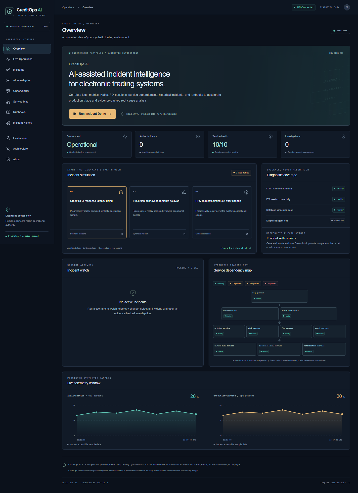
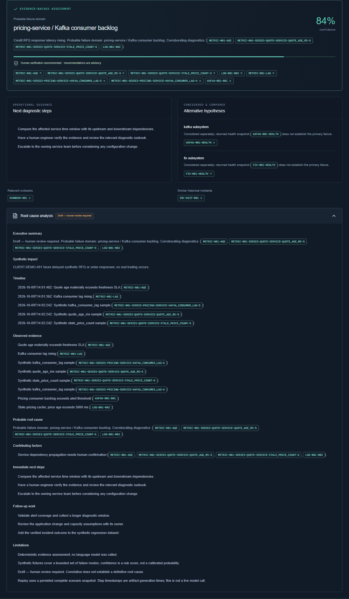
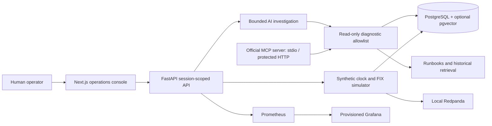

# CreditOps AI

**AI-assisted incident intelligence for synthetic electronic credit trading systems.**

CreditOps AI correlates logs, metrics, Kafka consumer state, FIX sessions, database health, service dependencies, application changes, historical incidents and runbooks into an evidence-backed investigation. It demonstrates the diagnosis, observability and safety boundaries a Production Support, SRE or AI Enablement engineer needs to design.

> CreditOps AI is an independent portfolio project using entirely synthetic data. It is not affiliated with or connected to any trading venue, broker, financial institution, or employer.



## Five-minute demo

1. Open Overview and select **Run Incident Demo**.
2. Choose **Kafka pricing lag**, **FIX connectivity**, or **Database pool exhaustion**, then **Run Incident**.
3. Observe changing telemetry on a clearly labeled simulated clock: one real second represents twelve synthetic seconds.
4. Open the detected incident and select **Investigate with AI**. The public path is explicitly labeled **Replay · deterministic provider**.
5. Watch the read-only tool trace, review the proposed failure domain and alternate hypotheses, and click evidence IDs to inspect the exact supporting records.
6. Open **Evaluations** to inspect generated results and their limitations. Reset the scenario and repeat.

Replay artifacts are produced by the actual diagnostic collection, assessment and evidence-validation pipeline. The checked-in artifacts use a deterministic provider, and **no model call is claimed**. Protected `LIVE_AI` uses configurable official OpenAI or Anthropic SDKs for diagnostic query selection and structured assessment. Live AI evaluation remains ungenerated until a real provider run is performed.



[Watch the recorded demo](docs/screenshots/demo.webm) or follow the [two-minute interview script](docs/DEMO_SCRIPT.md).

## The incidents

| Scenario | Independent observations | Probable failure domain |
|---|---|---|
| RFQ latency | Pricing consumer backlog, stale prices, quote age and upstream latency; healthy negative controls | Pricing service / Kafka consumer backlog |
| Acknowledgement delays | FIX heartbeat failures, reconnects, sequence gaps, uncertain synthetic orders; healthy DB/Kafka | FIX session instability |
| Request timeouts after change | Saturated connection pool, waiters, pool timeout logs, preceding release, normal CPU | Connection pool exhaustion following application change |

Twelve further labeled cases include stale market data, risk dependency timeouts, CPU pressure and three deliberately insufficient-evidence cases. Evaluation labels never enter diagnostic tools or model context.

## Architecture



The MCP HTTP bridge calls the same diagnostic API used by the investigator. SQLite supports a lightweight development path; Docker exercises PostgreSQL and a real Kafka-compatible broker. The frontend uses a server-side same-origin proxy; credentials remain on the server. The [architecture document](docs/ARCHITECTURE.md) describes persistence, trust boundaries and public-demo adaptations.

## Start locally

Requirements: Python 3.12+, Node.js 22+, pnpm, Git. Docker is optional for the lightweight path.

```sh
python -m venv .venv
# macOS/Linux: source .venv/bin/activate
# Windows PowerShell: .venv\Scripts\Activate.ps1
python -m pip install -r requirements.lock
python -m pip install --no-deps -e .
pnpm install --frozen-lockfile
python -m alembic upgrade head
python scripts/seed.py
python scripts/evaluate.py
pnpm dev
```

Open [the console](http://localhost:3000), [API health](http://localhost:8000/health) and [OpenAPI](http://localhost:8000/docs). `pnpm dev` starts both servers. If needed, start them separately with `python -m uvicorn creditops.main:app --host 127.0.0.1 --port 8000` and `pnpm --filter @creditops/web dev`.

On Windows without activating the environment, replace `python` with `.venv\Scripts\python.exe`. Copy `.env.example` to `.env` for local configuration. No AI credentials are required for replay.

## Full local infrastructure

```sh
docker compose -f infra/docker/compose.yml up --build -d
docker compose -f infra/docker/compose.yml ps
```

| Component | Isolated local URL |
|---|---|
| Web | http://localhost:13000 |
| API / OpenAPI | http://localhost:18000/docs |
| PostgreSQL / pgvector | localhost:15432 |
| Redpanda Kafka | localhost:19092 |
| Prometheus | http://localhost:19090 |
| Grafana | http://localhost:13001 |

All host ports bind to loopback. Disposable local credentials in Compose are intentionally fictional and must be replaced for hosting. `docker compose ... down` stops the stack while preserving its named volumes. No real FIX connection is created.

## Developer commands

| Command | Purpose |
|---|---|
| `pnpm dev` / `make dev` | Start API and console |
| `pnpm test` / `make test` | Python and frontend unit tests |
| `pnpm lint` / `make lint` | Python and frontend lint |
| `pnpm typecheck` | Strict frontend TypeScript |
| `pnpm test:dependencies` | Scoped lint dependency compatibility and active rule checks |
| `pnpm test:lifecycle` | Real Playwright/Linux launcher shutdown and descendant cleanup; explicit Unix-proof skip on Windows |
| `pnpm e2e` | Playwright all-scenario and responsive checks |
| `make seed` | Idempotent seed |
| `make eval` | Generate benchmark and replay artifacts |
| `make reset-demo` | Reset a selected local demo session |

Python packages are pinned in `requirements.lock`; pnpm dependencies are pinned in `pnpm-lock.yaml`. CI runs tests, lint, typecheck, E2E, dependency audits, Bandit and secret scanning.

## Why production mutation is intentionally excluded

CreditOps AI intentionally exposes diagnostic capabilities only. AI recommendations are advisory. Production mutation tools are excluded by design.

AI accelerates evidence collection and diagnosis while human engineers retain operational authority. There is no restart, rollback, scaling, record deletion, shell execution, configuration change or FIX termination tool. Read-only MCP registration and attempted forbidden actions are tested. Runbook commands are reference text and are never automatically executed. Every RCA is **Draft — human review required**.

## Engineering decisions

- **Evidence-grounded investigation:** structured assessments are checked against returned evidence IDs and evidence types. Unknown references invalidate output. Insufficient corroboration causes abstention and escalation.
- **Retrieval:** bounded diagnostic queries and explainable lexical ranking select context rather than dumping entire log stores into a model. Optional pgvector retrieval is available when configured.
- **Replay for public demos:** persisted pipeline artifacts cap spending and work without keys. Replay provenance, generation timestamps and deterministic assessment are visible.
- **Local Kafka, inexpensive cloud:** Redpanda supports real event publication/consumption locally. The public path uses persisted synthetic telemetry without a paid Kafka cluster.
- **Provider abstraction:** official SDKs, server-side configuration, validated tool plans, structured output, request deadlines and no automatic retries that could multiply costs.
- **Confidence and escalation:** rule scores are transparent and uncalibrated. Failed tools or weak evidence lower confidence and require review.

See [tradeoffs](docs/TRADEOFFS.md) for institutional-scale limitations.

## Evaluation methodology

The harness evaluates 15 labeled synthetic incidents using **Deterministic Baseline** and **Orchestrated Investigator (deterministic provider)**. It measures top-1/top-3 domain accuracy, required-evidence recall, invalid/hallucinated citations, abstention, escalation, runbook retrieval, tool errors and pipeline latency. Model tokens and estimated costs remain unavailable unless a model supplies usage and explicit pricing is configured.

Actual results are in [generated JSON](artifacts/eval/latest.json), [generated report](artifacts/eval/latest.md) and the Evaluations page. These are small, in-distribution fixtures designed alongside the rules. They do not prove generalization, guaranteed AI accuracy, actual customer usage or real production MTTR reduction.

Run `python scripts/evaluate.py --provider openai` or `--provider anthropic` only after configuring a server-side key, explicit model and desired pricing. These commands make real paid model calls. The default makes none.

## MCP

The [MCP README](apps/mcp/README.md) includes compatible-client configuration. Ten tools inspect incidents, logs, metrics, dependencies, changes, historical incidents, runbooks, Kafka, FIX and database health. Typed arguments reject unknown fields, enforce bounded results and sanitize secrets. Stdio works locally; hosted Streamable HTTP requires explicit protection.

## Security and configuration

`LIVE_AI` requires a configured server admin key and `Authorization: Bearer ...`, plus an investigation budget. Demo state is scoped to UUID sessions. Request-size caps, result limits, timeouts, log sanitization and evidence validation bound the attack surface. Untrusted telemetry cannot add tools or alter system instructions. An injection fixture and direct tests exercise this boundary. Session identifiers are capability tokens for synthetic data, not customer authentication.

The [version-controlled investigator prompt](apps/api/creditops/prompts/investigator.md) and [security document](docs/SECURITY.md) explain the threat model. The current single-instance in-memory rate limiter needs a shared store before multi-replica hosting. An admin key is a minimal demonstration mechanism, not institutional identity management.

| Variable | Role |
|---|---|
| `DATABASE_URL` | SQLite or asynchronous PostgreSQL URL |
| `API_BASE_URL` | Server-side Next.js proxy destination |
| `TELEMETRY_MODE`, `KAFKA_BOOTSTRAP_SERVERS` | Persisted demo or local Kafka adapter |
| `PUBLIC_DEMO` | Defaults true; prevents paid embedding queries in public diagnostic requests |
| `EMBEDDINGS_ENABLED`, `EMBEDDING_MODEL` | Optional private pgvector retrieval; explicit offline indexing setup |
| `AI_PROVIDER` | `openai` or `anthropic` for protected live mode |
| `OPENAI_MODEL`, `ANTHROPIC_MODEL` | Explicit model choice, no business-logic hardcoding |
| Provider API keys | Server-side only |
| `ADMIN_API_KEY` | Protect expensive live investigation |
| Investigation budget/deadline settings | Bound demo requests and costs |
| Provider pricing variables | Optional user-configured cost estimate |

## Deployment

Target: Vercel frontend, container-hosted FastAPI, Neon PostgreSQL. Docker and Render configuration are included. The cloud demo uses replay, persisted telemetry and no paid Kafka/Grafana. See [exact deployment steps](docs/DEPLOYMENT.md). External deployment status, actual tests, scans, browser checks and limitations are recorded in [the final report](docs/FINAL_REPORT.md). A local build or connector login is never described as a verified cloud deployment.

## Interview materials

- [Two-minute click-and-talk demo](docs/DEMO_SCRIPT.md)
- [Interview walkthrough and honest answers](docs/INTERVIEW_WALKTHROUGH.md)
- [Portfolio/resume summary](docs/PORTFOLIO_SUMMARY.md)
- [Architecture](docs/ARCHITECTURE.md), [tradeoffs](docs/TRADEOFFS.md), [security](docs/SECURITY.md)

Future improvements include independent held-out cases, live-provider comparative benchmarks, calibrated uncertainty, shared rate limiting, institutional authentication, retention controls and operator usability studies. This repository does not connect to a trading venue or perform remediation.
