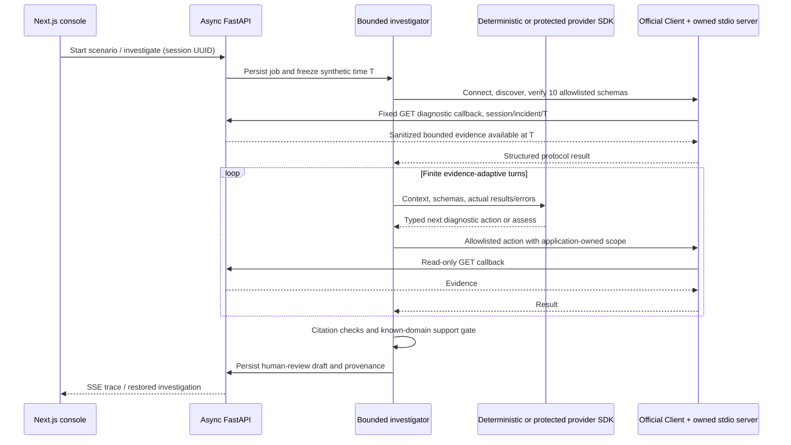

# Architecture

CreditOps AI connects synthetic RFQ processing to pricing, market/reference data, risk, FIX connectivity and database observations. FastAPI owns simulation and persistence; all diagnostic tools remain read-only.

The worker awaits asynchronous I/O while its MCP child calls back into the same API. A real integration test launches that arrangement, runs all three scenarios and compares returned evidence. A forced child exit cannot complete successfully. Stdio connections/subprocesses use the official SDK lifecycle. The existing protected Streamable HTTP listener remains optional; no new public endpoint was added.

## Three execution paths

| Path | Collection | Tool selection | What it proves |
|---|---|---|---|
| REPLAY | Recorded complete snapshot generated by direct adapter | Recorded initial plan | Reproducible UI and prior deterministic pipeline output |
| MCP_DEMO | Fresh official-SDK stdio calls | Deterministic decisions after actual results | Protocol, adaptive orchestration, scope and evidence integrity |
| LIVE_AI | Same MCP interface | Official OpenAI/Anthropic structured SDK responses | Implemented and offline-tested only; live execution NOT RUN, quality UNVERIFIED |

The direct adapter remains explicit for the original evaluation and local tests. MCP failure never switches to direct collection. The model chooses an allowed tool and bounded filters; the application owns session, incident, cutoff, API URL, transport and budgets. Provider context excludes scenario tags, titles, fixture labels and ground truth. Historical retrieval excludes the current incident and future records.

The adaptive loop provides sanitized result/error records and collected evidence between decisions. Default limits are 12 provider turns (including final assessment), 12 diagnostic calls (including context), two unproductive calls, 10 seconds per diagnostic, 20 seconds per provider call and 45 seconds total. Identical repeated requests terminate safely. Evidence is capped at 250 objects/90KB serialized; provider input is independently bounded to 120KB. Failures are explicit unknowns. There is no hidden chain-of-thought display.

## Diagnostic correctness

Structured observations cite returned records. Saturation plus same-service waits/timeouts can establish pool exhaustion without a deployment. Only a same-service deployment strictly before symptom onset within a one-hour window is a candidate trigger. It never automatically becomes a confirmed cause. Latest healthy telemetry cannot be silently displaced by older unhealthy samples. Multiple conflicting supported domains cause abstention.

The validator checks reference existence/type, independently tests cited and total observed support, and rebuilds known-domain display fields using conservative rules. This is a small synthetic-domain gate, not a general factuality guarantee. A valid ID does not make arbitrary causal prose true. Scores are uncalibrated support, not probabilities. Every draft requires human review. Runbooks/history guide next checks; they do not prove the current cause.

## Time, persistence and business events

SQLAlchemy persists operational evidence, sessions/runs, investigations, three fictional instruments, RFQs and business events. PostgreSQL/pgvector is the intended relational store; SQLite is the lightweight fallback. The API retains writer authority for simulation and persistence, while MCP has only fixed GET routes.

Synthetic time advances twelve seconds per wall second. An investigation freezes T and requires both reveal availability and observation timestamp <= T. Business counters are reduced from returned events at the same cutoff. A replay is explicitly a complete recorded scenario snapshot, may include observations later than the current simulation, preserves original evidence/step times and records its generation timestamp. Replay format v2 adds transport/cutoff provenance; v1 remains readable and checksummed. Checksums detect corruption, not malicious repository replacement.

The tiny lifecycle deliberately separates:

- RFQ: OPEN -> COMPLETED on valid quote acceptance, or EXPIRED on an observed deadline event.
- Quote: UNAVAILABLE -> FRESH -> STALE/EXPIRED, or ACCEPTED while fresh and before both quote/RFQ expiry. Expiry observations must meet the relevant deadline.
- Processing: RECEIVED -> WAITING_PRICING/DB_WAIT -> QUOTE_AVAILABLE or TIMED_OUT.
- Order: valid accepted quote -> PENDING_ACK -> UNKNOWN or ACKNOWLEDGED. An acknowledgement is not execution. Retransmission retains the same economic order ID and cannot create a second order.

Fixtures contain no confirmed execution. Pricing backlog has an expired quote and an unavailable quote, then observed RFQ expiries. FIX has two accepted quotes and two orders with uncertain acknowledgements. DB exhaustion has two waiting RFQs with processing timeouts. Requested par, coupon percent and clean price per 100 par use Decimal and JSON strings. Requested par is neither financial loss nor settlement value; accrued interest, fees, settlement, yield and P&L are out of scope.

Local Docker runs real PostgreSQL, Redpanda publication/consumption, Prometheus and Grafana. Diagnostic lag and all FIX/business activity remain synthetic. Optional embeddings are disabled in public mode; none were called in this pass.

## Institutional requirements

Before real use: entitlement-aware data access, enterprise identity, immutable audited evidence, durable jobs, shared rate/cost limits, retention, production data-quality/time synchronization controls, operator reconciliation procedures, independently labeled evaluation, calibrated uncertainty and human usability studies. No cloud deployment or autonomous remediation was performed.

The implementation follows the pinned official [MCP Python SDK](https://py.sdk.modelcontextprotocol.io/), [OpenAI structured Responses](https://developers.openai.com/api/docs/guides/structured-outputs?api-mode=responses) and [Anthropic structured Messages](https://platform.claude.com/docs/en/build-with-claude/structured-outputs). Offline SDK parsing tests are not live-provider receipts.
