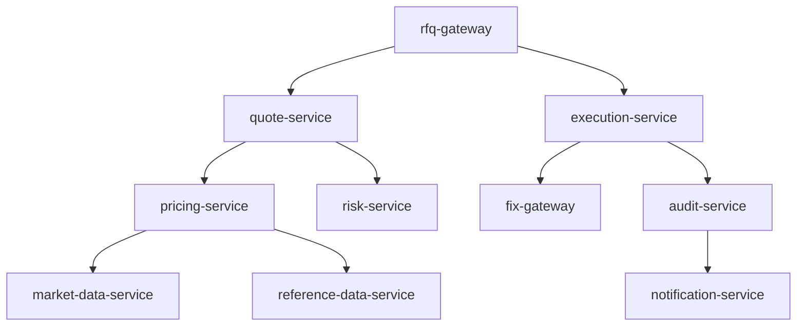
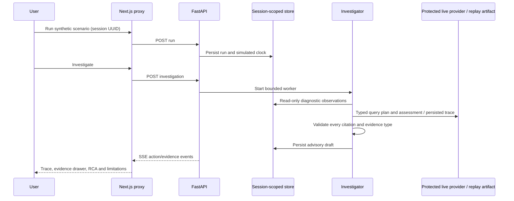

# Architecture

CreditOps AI models a synthetic credit RFQ lifecycle: an RFQ gateway asks quote-service for pricing and risk checks; pricing depends on market/reference data; execution waits for fictional FIX acknowledgement and writes an audit event.

## Request and investigation boundaries

A diagnostic tool may read synthetic observations but never reset a scenario, publish an order, mutate application configuration or execute a runbook command. Scenario controls and investigation storage belong to the demo application, outside the agent tool allowlist.

## Persistence

SQLAlchemy owns services/dependencies, incidents/runs, logs, metric samples, Kafka/FIX snapshots, deployments, runbooks, history, investigations/steps and evaluation-related entities. Evidence IDs are stable semantic IDs; run and investigation identity is session-scoped. Migrations establish indexes and PostgreSQL vector support. Seed/reset is deterministic and idempotent. Evidence records contain time and provenance, and are exposed as bounded typed objects.

The development SQLite fallback preserves the same API while simplifying startup. PostgreSQL exercises the intended relational implementation. A separate diagnostic read-only database role can inspect operational tables; administrative migrations and demo persistence require a write role. The diagnostic facade enforces read-only methods even when the application owns writable state.

## Telemetry and clock

Scenario fixtures have explicit synthetic UTC timestamps and reveal offsets. The simulated clock advances twelve telemetry seconds per wall second; the UI labels it. Time does not represent real trading activity. Local Kafka mode publishes and consumes synthetic events through Redpanda; replay mode reads persisted telemetry. Broker interaction is distinct from fixture measurements: the dashboard's modeled pricing backlog is synthetic, not claimed to be the broker's actual consumer lag.

The FIX simulator models connected state, heartbeat age, sequence numbers, gaps, reconnects and acknowledgement latency. It never creates a socket to a venue.

## Retrieval and model context

Lexical ranking considers tokens, error signatures and service overlap, and returns explanations. Optional vectors require pgvector and configured embeddings. No external embeddings are needed for the demo. Investigation labels live in `data/evaluations/cases.json` and are read only by scoring. Tools never return labels.

Live providers receive a sanitized incident, choose a typed bounded plan, read diagnostic results, and produce a structured assessment. This is a deliberately bounded two-stage orchestration, not an unrestricted autonomous agent. The deterministic provider uses independent observed signals and explicit abstention; its replay artifacts are labeled with provider and model-call provenance.

A conservative support gate independently checks the cited observations against this deployment's known synthetic failure-domain taxonomy. A valid ID pointing to normal telemetry cannot justify a confident diagnosis. Unknown or uncorroborated domains are downgraded to insufficient evidence and human review. This guard is deliberately specific to the fixtures; extending the platform requires versioning and testing new domain support checks.

The implementation uses current official [OpenAI structured Responses](https://developers.openai.com/api/docs/guides/structured-outputs?api-mode=responses), [Anthropic structured Messages](https://platform.claude.com/docs/en/build-with-claude/structured-outputs), and the [official MCP Python SDK](https://github.com/modelcontextprotocol/python-sdk). Offline HTTP transport tests exercise the installed SDK serialization/parsing; they do not establish real provider availability or model quality.

## Real locally, replayed publicly, optional externally

| Capability | Full Docker environment | Public replay deployment |
|---|---|---|
| PostgreSQL persistence | Real pgvector-enabled PostgreSQL | Neon-compatible PostgreSQL |
| Event stream | Real Redpanda publish/consume | Persisted synthetic evidence |
| FIX | Synthetic state simulator | Synthetic persisted state |
| Investigation | Actual bounded pipeline / optional live provider | Persisted pipeline actions and assessment |
| Metrics | Real application Prometheus instrumentation plus synthetic diagnostic metrics | Synthetic metric views inside console |
| Grafana | Provisioned dashboard | Optional, unnecessary |
| Embeddings | Optional configured vectors | Lexical fallback |

At institutional scale, replace bearer demo administration with identity and authorization, enforce tenant entitlements, move workers to a durable queue, share rate budgets, implement retention and audit controls, and evaluate on independently labeled held-out incidents.
