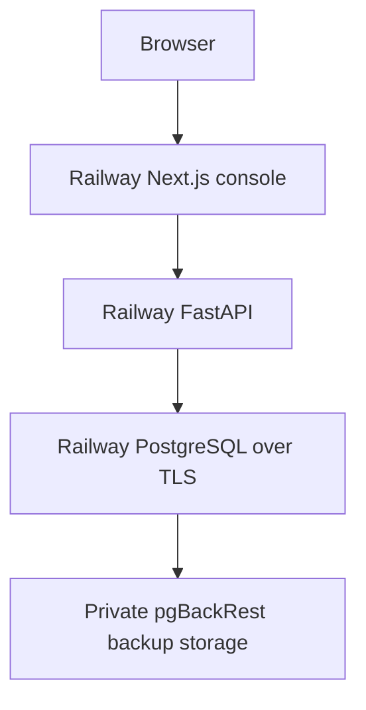

# CreditOps AI production deployment

Verified topology: October 24–25, 2026. [Live showcase](https://creditops.farhan-shafee.com) · [Public source](https://github.com/farhan-shafee/creditops-ai).

The Next.js frontend, FastAPI API, PostgreSQL database and private off-volume backup storage run on Railway. Cloudflare supplies DNS. Vercel and the frozen pre-cutover Neon copy are retained for controlled rollback; neither is the active application database or canonical frontend.

## Public and local boundaries

The public showcase plays three recorded model-assisted investigations with synthetic pricing/Kafka, FIX and database-pool evidence. Playback makes no new model or MCP diagnostic calls. Fresh read-only MCP diagnostics are a separate mode; recordings do not demonstrate model-selected diagnostic follow-ups. Initiating causes remain unconfirmed and every advisory requires human review.

The API persists synthetic sessions and application state with a restricted application role. MCP tools expose fixed read-only diagnostic callbacks, not operational mutation. Optional embeddings and paid live investigations are disabled in public mode. Local Compose additionally runs Redpanda, Prometheus and Grafana; those local components are not separate production services.

## Source and release configuration

Both production application services follow this public repository's `main` branch, without a commit pin. The October 24 release used `e511cb40338be086afafdcac51f8377b21aae858`; [all four quality CI jobs passed](https://github.com/farhan-shafee/creditops-ai/actions/runs/40140532920). CI is separate from the Railway trigger: the observed source configuration has `checkSuites=false`, so do not claim Railway waits for CI. Inspect the reviewed source and CI before publishing a release.

| Service            | Build and runtime                                                                                                |
| ------------------ | ---------------------------------------------------------------------------------------------------------------- |
| Frontend           | Railway Railpack, repository-root context, frozen pnpm install, `@creditops/web` build and standalone asset copy |
| Frontend start     | `node apps/web/.next/standalone/apps/web/server.js`; health `/`                                                  |
| API                | `infra/docker/api.Dockerfile`, repository-root context; health `/health`                                         |
| API startup        | Existing Alembic-head check followed by Uvicorn on `0.0.0.0:$PORT`                                               |
| Database           | Private Railway PostgreSQL 17.11; pinned compatible image, 1,000 MB volume; no public TCP proxy                  |
| Operations monitor | Railway Function every 15 minutes; expected to complete between executions                                       |

The frontend's standalone output must include its `.next/static` and `public` assets. Do not substitute a different start layout without checking those paths.

## Configuration and database authority

Keep values in Railway's project-scoped configuration. Do not upload workstation dotenv files or expose secrets through `NEXT_PUBLIC_*`.

| Variable               | Purpose                                                                |
| ---------------------- | ---------------------------------------------------------------------- |
| `API_BASE_URL`         | Server-only HTTPS API destination for the frontend                     |
| `DATABASE_URL`         | Private PostgreSQL connection using `creditops_app`; resolve privately |
| `DATABASE_REQUIRE_SSL` | `true`                                                                 |
| `PUBLIC_DEMO`          | `true`                                                                 |
| `REPLAY_DIR`           | `/app/data/showcase`                                                   |
| `EMBEDDINGS_ENABLED`   | `false`                                                                |
| `TELEMETRY_MODE`       | `persisted`                                                            |
| `CREDITOPS_ENV_FILE`   | Explicitly empty in the hosted public profile                          |
| `CORS_ORIGINS`         | Exact approved frontend origins                                        |
| Model/admin keys       | Not required by public recorded playback                               |

The API writer role and database operations/admin role are separate. Review new migrations with the appropriate administrative authority before a release; the already-reviewed startup command is not authorization to grant broad runtime privileges. Never seed, reset or migrate another project's database. The current single-process limiter needs shared coordination before multi-replica hosting.

## Backups and recovery

The production PostgreSQL image uses pgBackRest with continuous WAL archiving, a 60-second archive timeout, weekly full backups, daily differential backups, and retention of four full/fourteen differential sets in private off-volume storage. These settings are not Railway managed volume snapshots.

The October 24 full backup containing the migrated data was independently downloaded and restored into an isolated fresh volume. All twelve recorded data/schema comparison groups passed. No production restore was performed. A configured cadence and one successful drill do not establish every future backup, retention cycle, chosen-time recovery or RPO/RTO guarantee.

The 15-minute monitor checks public health and backup catalog integrity/freshness. Review failed attempts, archive gaps, capacity and stale/missing results even if an older full backup remains fresh. Catalog checks do not validate every referenced object or establish an alert-delivery guarantee.

For a recovery drill, use a fresh isolated volume and the compatible pinned image, disable archiving in the recovery instance, expose no public SQL port, wait for recovery to finish, then validate the selected backup's data/schema and access controls. A production replacement needs its own archive destination; do not let two active clusters archive into the same repository history.

## Release acceptance and rollback

After an authorized release:

1. Verify Railway reaches terminal SUCCESS at the reviewed commit for both application services.
2. Check the canonical website, frontend health/overview proxies and direct API health.
3. Inspect all three recorded investigations, their evidence/provenance, original proposals and validation; check desktop/mobile and session isolation.
4. Confirm public live-model requests remain denied, no fresh provider calls are made during playback, and secret values never appear in logs or browser output.
5. Review running/crashed replicas, bounded errors, HTTP 5xx, resource use and backup/archive progress. Record timestamps; do not treat a past receipt as current uptime proof.

Use a compatible retained application deployment for an application rollback while retaining the current Railway database. Neon is a frozen pre-cutover copy, not a synchronized standby. After Railway has accepted writes, changing the API back to stale Neon would lose those writes: stop writers and reconcile/reverse-migrate under a separate recovery plan, or roll forward.

Vercel, paused rehearsals and older pilot resources remain retained. Their retirement is a separate, explicitly approved cleanup step.

## Local development and historical evidence

[README](../README.md) and [local infrastructure](../infra/README.md) retain the lightweight SQLite and full Compose paths. Build the API locally with `docker build -f infra/docker/api.Dockerfile -t creditops-ai-api .`.

The [original final report](FINAL_REPORT.md), [second-pass report](SECOND_PASS_REPORT.md) and [recorded-model verification](LIVE_VERIFICATION_REPORT.md) describe their named milestones and source revisions. Their earlier no-hosting/private-source statements are historical; this runbook describes the current deployment. Render configuration is an unused alternative, not the active production host.
